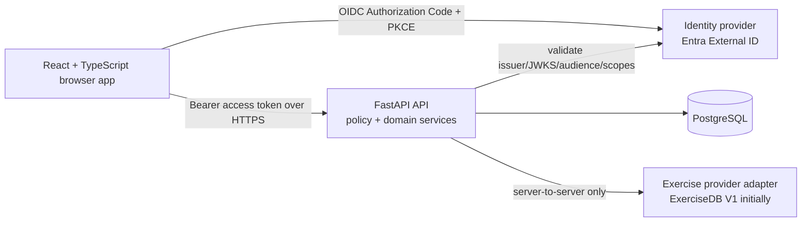

# Unshaken — Phase 1 Product and Technical Plan

This is a planning proposal, not approval to implement. Requirements explicitly stated by the owner are marked **Approved direction**. Recommendations marked **Owner decision** need confirmation before implementation.

## 1. Phase 1 goals and user value

**Goal:** deliver a secure, invitation-only, responsive web application that lets invited people discover Exercises, create private custom Exercises, and organize both standard and custom Exercises into personal Workout templates.

A user gains a usable planning tool without needing to manage a password, manually maintain a standard exercise catalog, or expose their data to other users. The owner gains controlled access through email invitations and can deactivate access when necessary.

Phase 1 deliberately stops before a **Workout session** can be started or recorded. This preserves focus on a reliable foundation for later workout logging, history, and reporting.

## 2. User roles and permissions

| Role | Permissions |
|---|---|
| Application owner | Invite, resend invitation, revoke/expire invitation, activate/deactivate user accounts, and view limited account administration information. The owner must not gain implicit access to members’ private Workout templates or custom Exercise contents unless a later, explicit support/privacy policy permits it. |
| Invited member | Authenticate only through an active invitation; view standard Exercise catalog data; manage their profile; create, edit, archive/delete, and use only their own custom Exercises; create, edit, archive, duplicate, reorder, and view only their own Workout templates. |
| Unauthenticated visitor | May see only a minimal landing/login screen. No catalog, templates, custom Exercises, or user data. |
| External Exercise provider | Has no application role and receives only necessary backend requests. It never receives Unshaken authentication tokens or member-specific data. |

Authorization is enforced by FastAPI on every protected request. React may hide unavailable actions for usability, but is never the authorization authority.

## 3. User journeys

1. **Owner invites a member:** owner enters an email address, the system creates a time-limited invitation, and a single-use invitation link is delivered through an approved email mechanism. The owner can revoke or resend it.
2. **Member signs in:** member opens the application, chooses Google, Microsoft, or email one-time passcode, completes the identity-provider flow, and FastAPI accepts the user only when the validated token email matches an active invitation and active local account.
3. **Member browses Exercises:** member searches and filters standard Exercises, opens details, sees provider attribution where required, and can add a standard Exercise to a Workout template.
4. **Member manages a custom Exercise:** member creates a private Exercise with structured fields, edits it later, archives it when no longer wanted, and uses it in a Workout template.
5. **Member manages a Workout template:** member creates “Upper Body,” adds Exercises in order, configures planned sets, repetitions, rest, and notes, changes the order, duplicates the template, and archives it. No Workout session is created in Phase 1.
6. **Provider outage:** member sees a clear, accessible message that standard Exercise catalog data is temporarily unavailable; existing private custom Exercises and Workout templates remain available.

## 4–5. Detailed user stories and testable acceptance criteria

### US-01 — Invitation administration

As the application owner, I want to invite an email address so that only people I choose can access Unshaken.

Acceptance criteria:

- An owner can submit one valid email address and receives a success result that does not disclose whether unrelated addresses have accounts.
- The system normalizes email comparison consistently, creates an invitation with creator, creation time, expiry time, active state, and single-use redemption state.
- Inviting an already active member does not create a second usable account; the API returns an owner-appropriate idempotent result.
- The owner can revoke an unredeemed invitation, after which it cannot be redeemed.
- A non-owner receives `403` for every invitation administration endpoint.
- Invitation, resend, revoke, and account status actions create audit events without logging tokens or one-time codes.

### US-02 — Invitation-only authentication

As an invited member, I want to sign in using Google, Microsoft, or email one-time passcode so that I can safely access my own planning data.

Acceptance criteria:

- The web client uses browser-based OAuth 2.0/OpenID Connect authorization code flow with PKCE; it does not receive or store an ExerciseDB key.
- FastAPI validates token signature against trusted issuer keys, issuer, audience, expiration, not-before time, and relevant authorized-party/nonce requirements before accepting a request.
- FastAPI maps the validated `(issuer, subject)` to a local identity and compares a verified email claim using the defined normalized-email rule.
- A valid identity token alone is insufficient: FastAPI rejects requests when no matching active invitation exists, the invitation is expired/revoked/unredeemed as applicable, or the local user is inactive.
- A user authenticated as one invited email cannot substitute another email in request bodies, query parameters, or headers to access data.
- Sign-out clears the client authentication state and protected API calls thereafter receive `401`.

### US-03 — Member profile foundation

As an active member, I want to view and update my basic profile so that the application has a stable account foundation.

Acceptance criteria:

- A member can read only their own profile and update only approved member-editable fields, initially display name and preferences such as units.
- Email, role, account state, identity provider subject, invitation state, and audit data are not member-editable.
- The API derives the member identity from the validated token, never from a client-supplied user identifier.
- Invalid profile input returns field-level validation messages and does not partially update other fields.

### US-04 — Browse and search standard Exercises

As an active member, I want to browse, search, and filter standard Exercises so that I can find Exercises for a Workout template.

Acceptance criteria:

- The React application requests standard Exercise data solely from FastAPI; browser network traffic never calls ExerciseDB directly.
- Search supports the provider-supported or normalized criteria approved for Phase 1, initially name plus body area, equipment, and exercise type filters.
- Results identify their external source, return an internal normalized model, and show required attribution.
- A catalog request yields an accessible loading state, empty result state, and recoverable provider-error state.
- FastAPI enforces page size bounds and request timeouts and does not expose the provider key or raw upstream error body.
- The catalog does not silently substitute stale or permanently copied provider data if the selected provider terms do not permit it.

### US-05 — View standard Exercise details

As an active member, I want to see details of a standard Exercise so that I can decide whether to use it.

Acceptance criteria:

- Details are retrieved through FastAPI using the source/provider identifier, not a client-controlled arbitrary URL.
- The normalized response handles absent instructions, media, equipment, body area, or optional metadata without breaking the page.
- Unavailable image/video media receives a non-blocking fallback and meaningful alternative text or an explicitly decorative treatment.
- Provider attribution and any required license notice are displayed near the source content.
- If an external Exercise is missing or unavailable, the response clearly distinguishes “not found” from temporary upstream failure.

### US-06 — Create and manage private custom Exercises

As an active member, I want to create and manage private custom Exercises so that my personal movements can be used in my plans.

Acceptance criteria:

- A member can create a custom Exercise with required name and exercise type and optional targeted body area, equipment, instructions, and notes, subject to defined validation and length limits.
- A custom Exercise is assigned to the authenticated owner server-side; a submitted owner ID is ignored or rejected.
- The owner can edit their custom Exercise; another member receives `404` or `403` without receiving its content.
- The owner can archive a custom Exercise. A hard delete is allowed only when it has no Workout template references; otherwise the system archives it and preserves referential integrity.
- Archived custom Exercises are excluded from new-selection lists by default but existing Workout template references remain readable with an archived indicator.
- The custom Exercise API and UI do not mix external provider content into user-owned records.

### US-07 — Create and edit Workout templates

As an active member, I want to create and name several Workout templates so that I can organize planned routines.

Acceptance criteria:

- A member can create a named Workout template and sees it only in their own list.
- The API assigns ownership from the authenticated identity and returns no other member’s templates.
- A member can rename, update permitted metadata, archive, restore if that is approved, or duplicate their own Workout template.
- Duplication creates a new owner-scoped template and copies its ordered Exercise plan and planned sets without linking edits between originals and copies.
- Empty names, whitespace-only names, and invalid field lengths are rejected with actionable validation errors.
- An archived Workout template is hidden by default, can be included through an explicit filter, and cannot be selected for Phase 2 workout logging until restored.

### US-08 — Add and configure Exercises in a Workout template

As an active member, I want to add standard and personal Exercises to a Workout template and define the plan for each one.

Acceptance criteria:

- A member can add either a normalized external Exercise reference or a custom Exercise they own; no third member’s custom Exercise can be referenced.
- Each template Exercise stores an immutable source discriminator and either an external `(provider, provider_exercise_id)` reference or a custom Exercise foreign key, enforced by database constraints.
- A member can configure ordered planned sets, planned repetitions, rest seconds, and optional notes for each template Exercise.
- Set count, repetition values, rest seconds, item count, notes, and ordering values have explicit validation ranges decided before implementation.
- Adding, editing, or removing an item from a template owned by another member fails without changing data.
- Removing an item removes only that plan entry; it does not delete the underlying custom Exercise or external source data.

### US-09 — Reorder Workout template Exercises

As an active member, I want to reorder Exercises in a Workout template so that my plan is in the intended sequence.

Acceptance criteria:

- The reorder operation accepts the complete expected item identifier list and rejects duplicates, omissions, unknown IDs, or IDs owned by a different template.
- The resulting order is contiguous and deterministic.
- Concurrent changes are protected with an optimistic version/ETag or transaction-level conflict strategy; a stale reorder returns `409` rather than silently overwriting the newer order.
- The UI supports keyboard-accessible reordering and an alternative move-up/move-down control; drag-and-drop alone is insufficient.
- The reordered sequence persists after refresh and is returned consistently from the API.

### US-10 — Data isolation and account deactivation

As the owner, I want to deactivate an account so that a member can no longer access Unshaken without destroying necessary records.

Acceptance criteria:

- An owner can set a member account inactive, with reason category and audit metadata as approved.
- FastAPI blocks every subsequent protected call from an inactive account even if a previously issued identity-provider token has not expired.
- Deactivation preserves records and ownership for audit and future reactivation; it does not transfer private Exercises or Workout templates.
- Deactivated users are not returned by routine member-facing endpoints.
- A non-owner cannot activate, deactivate, or enumerate other accounts.

### US-11 — Resilience and recovery

As an active member, I want understandable failure handling so that a provider or network issue does not make the application misleading or unusable.

Acceptance criteria:

- Upstream timeouts, connection failures, malformed provider responses, `429`, and `5xx` errors map to documented API errors that do not expose keys, stack traces, or raw provider bodies.
- A `429` preserves an upstream `Retry-After` value when safe and communicates when the member can retry.
- Template and custom Exercise operations continue when the external catalog is unavailable.
- Error messages are accessible, do not disappear before a screen reader can announce them, and offer a retry action when retry is appropriate.
- Logs and telemetry contain correlation IDs and safe status/category metadata, never access tokens, one-time passcodes, authorization headers, or secret values.

### US-12 — Responsive and accessible planning experience

As a member using a phone, keyboard, or assistive technology, I want to manage Workout templates without losing capability.

Acceptance criteria:

- Supported current desktop and mobile browsers display all Phase 1 flows at 320 CSS pixels wide through large desktop widths without horizontal page scrolling or hidden required controls.
- Touch targets, focus indicators, labels, error associations, contrast, headings, landmarks, and keyboard order meet the project’s chosen WCAG 2.2 AA standard.
- All dialogs manage focus, have a labelled title, support Escape where appropriate, and return focus to the invoking control.
- Important state changes, including validation and save success/failure, are announced appropriately.
- Responsive tests cover representative narrow and wide viewports and do not treat a visual snapshot alone as proof of accessibility.

## 6. Included and excluded functionality

Included:

- Invitation-only access, owner account administration, and user profile foundation.
- Google, Microsoft, and email one-time-passcode sign-in, subject to owner approval of the Entra External ID setup.
- Standard Exercise browsing, search, filters, details, attribution, and resilient ExerciseDB integration.
- Private custom Exercise lifecycle.
- Personal Workout template lifecycle, ordered Exercises, planned sets, repetitions, rest, and notes.
- Responsive accessible web UI.
- Automated tests, Docker local development, deployment plan, infrastructure readiness, and operational documentation.

Explicitly excluded:

- Starting, pausing, completing, or recording a **Workout session**.
- Actual weight, repetitions, completed sets, or RPE recording.
- Previous performance, history, personal records, charts, reports, timers, and notifications.
- Template sharing, social features, payments, subscriptions, coaching, or community content.
- Native iOS/Android apps.
- Persistent import, bulk harvesting, or archival of ExerciseDB content or media.

## 7. Recommended application architecture

**Recommendation:** a modular monorepo with three deployable concerns: React single-page application, FastAPI API, and PostgreSQL. Both application services are containerized, and application code depends on interfaces rather than Azure SDKs or ExerciseDB response shapes.



- **Frontend:** React + TypeScript, router, server-state query layer, component library/design tokens owned by Unshaken, schema-driven form validation, and accessibility-first components. No provider API calls or provider keys.
- **API:** FastAPI with route layer, authentication/authorization dependency, application services, domain models, repository interfaces, SQLAlchemy/Alembic or equivalent migration tooling, and integration adapters.
- **Database:** PostgreSQL with foreign keys, check constraints, unique constraints, transactional writes, UTC timestamps, migrations, and least-privileged connection roles.
- **Integration boundary:** `ExerciseCatalogProvider` interface with `search`, `get_by_id`, `list_filter_values` if supported, and normalized error types. `ExerciseDbV1Provider` is one implementation.
- **Identity boundary:** `IdentityProviderVerifier`/OIDC verifier abstraction driven by issuer discovery/JWKS and a local `IdentityLink` model; application authorization uses only Unshaken’s local account, invitation, and role state.
- **Operations:** structured logging, health/readiness endpoints that do not require the Exercise provider, metrics/trace correlation, backups, and dependency monitoring.

## 8. Recommended repository and folder structure

```text
/
  frontend/
    src/
      app/                 # routing, providers, app shell
      features/
        auth/
        profile/
        exercises/
        custom-exercises/
        workout-templates/
      components/          # shared accessible UI only
      api/                 # typed API client, not provider clients
      styles/
    tests/
  backend/
    app/
      api/                 # FastAPI routes and request/response schemas
      application/         # use cases and orchestration
      domain/              # entities, policies, provider interfaces
      infrastructure/
        db/                # ORM/repositories
        identity/          # OIDC validation implementation
        exercise_providers/
      migrations/
    tests/
      unit/
      integration/
      contract/
  infrastructure/
    docker/
    azure/                 # provider-neutral modules where practical
  docs/
    architecture/
    decisions/             # ADRs
    operations/
  compose.yaml
  .env.example             # variable names only, no values/secrets
```

## 9. Database entities, important fields, ownership, and relationships

| Entity | Key fields | Owner/visibility | Relationships |
|---|---|---|---|
| `user_account` | UUID, normalized_email, display_name, role, status, units, timestamps, version | Local account; owner or member | Identities, invitations as invitee, custom Exercises, Workout templates |
| `identity_link` | UUID, user ID, issuer, subject, verified email snapshot, linked timestamps | System-managed | Unique `(issuer, subject)`; belongs to one user |
| `invitation` | UUID, normalized_email, status, expires_at, redeemed_at, invited_by, token-hash/reference, timestamps | Owner-administered | Inviter and optional redeemed user |
| `audit_event` | UUID, actor user ID nullable, action type, target type/id, correlation ID, safe metadata, timestamp | Owner/operations retention policy | References actor/target; no credentials |
| `custom_exercise` | UUID, owner user ID, name, exercise type, body area, equipment, instructions, notes, lifecycle status, timestamps, version | Private to owner | May be used by template Exercise rows |
| `workout_template` | UUID, owner user ID, name, status, version, timestamps | Private to owner | One-to-many template Exercises |
| `template_exercise` | UUID, template ID, position, source kind, external provider, external Exercise ID, custom Exercise ID nullable, rest seconds, notes | Inherits template owner | One-to-many planned sets |
| `template_planned_set` | UUID, template Exercise ID, position, planned repetitions, optional notes | Inherits template owner | Belongs to template Exercise |
| Future `exercise_share_grant` | custom Exercise ID, grantee/principal, permission, status | Not Phase 1 | Enables sharing without ownership changes |
| Future `workout_session` / `session_exercise` / `completed_set` | template snapshot/reference, timestamps, actual load/repetitions, completion state | Phase 2 | Execution record separate from templates |

Important constraints:

- Store UUID primary keys, UTC timestamps, `created_at`, `updated_at`, and a concurrency version on mutable aggregates.
- Normalize email conservatively. Do not strip dots, plus tags, or apply provider-specific alias rules without explicit approval.
- Enforce database owner foreign keys and route-level ownership predicates.
- A custom Exercise may be archived while referenced. A Workout template retains its external provider ID but does not persist external descriptions, instructions, media addresses, or media bytes.
- Use migrations for every schema, index, constraint, and data-change operation.

## 10. Authentication and invitation flow

1. Owner creates an invitation for a normalized email. Store only a hashed opaque redemption secret or provider-managed invite reference and send an expiring, single-use link.
2. Member follows the link or starts login. React safely records state/return path and starts OIDC authorization code flow with PKCE.
3. Microsoft Entra External ID presents Google, Microsoft, and email OTP options configured for the external tenant.
4. The identity provider authenticates the member and returns an authorization response. React obtains API access tokens according to the approved design.
5. Every protected FastAPI request independently validates the access token through standard OIDC metadata and JWKS.
6. FastAPI resolves the identity link, checks invitation email and redemption state, confirms invitation and local user are active, then calculates authorization from local role and resource ownership.
7. A deactivated account is blocked immediately at the API policy layer.
8. The application records safe audit events for invitation and account-state actions.

**Recommendation:** use an Entra External ID external tenant, hosted browser sign-in, authorization code + PKCE, Google federation, Microsoft account/Entra federation as supported by the selected tenant configuration, and local email OTP. This requires approval because tenant selection, policy configuration, user-flow behavior, and billing are external commitments. [Microsoft’s authentication-method documentation](https://learn.microsoft.com/en-us/entra/external-id/customers/concept-authentication-methods-customers) supports Google, Microsoft Entra ID federation, custom OIDC/SAML providers, and email OTP.

Validate the exact “Microsoft account” experience with a proof of concept before promising a consumer Microsoft-account button.

## 11. ExerciseDB integration and failure handling

**Approved direction:** React calls FastAPI; FastAPI calls an adapter; ExerciseDB is the initial source; free V1 is used where practical; keys stay server-side; responses are normalized; replacement must remain possible.

Adapter contract:

- Internal model: `source`, `source_exercise_id`, name, exercise type, target body area(s), equipment, instructions/metadata where lawful, current media presentation reference, attribution, and availability indicators.
- Provider adapters map upstream data into this model. Routes, UI components, and database tables never depend on raw ExerciseDB fields.
- Template rows store only `provider` and `provider_exercise_id` for standard Exercises, plus user-owned planning settings.
- Configuration and any provider key stay on the backend.

The supplied [ExerciseDB repository](https://github.com/exercisedb/exercisedb-api) describes a hosted API and warns that exploration endpoints may have strict rate limits and instability. It does not establish that the full dataset is stored in the repository.

ExerciseDB’s published [terms of use](https://exercisedb.notion.site/ExerciseDB-API-Terms-of-Use-226983b728ca8090bf7be79564e4b356) currently restrict persistent storage and bulk collection, and may limit temporary caching. Treat the exact V1 production, rate-limit, attribution, caching, media, and key terms as a launch gate requiring current owner confirmation.

Failure handling:

- Apply conservative connect, read, and overall timeouts; validate schemas; bound page/filter requests; use per-provider circuit breaking.
- Convert upstream `429` into a normalized throttling response with safe `Retry-After`.
- Convert timeout, unavailable service, invalid schema, and `5xx` failures into a recoverable `503` response.
- Keep private custom Exercise and Workout template workflows available during provider outage.
- Treat media as optional; use a non-blocking fallback if media is unavailable.
- Do not persist source data, media, thumbnails, descriptions, instructions, or raw payloads unless the approved contract expressly permits it.
- Use an adapter test double so tests do not depend on the live provider.

## 12. Proposed FastAPI endpoints

All `/api/v1` endpoints except health endpoints require HTTPS, validated access tokens, and active-account policy.

| Method / route | Purpose |
|---|---|
| `GET /health/live` | Process liveness. |
| `GET /health/ready` | Database readiness; provider status reported separately. |
| `GET /me` | Current active member profile and role. |
| `PATCH /me` | Update allowed profile preferences. |
| `GET /admin/invitations` | Owner invitation list/filter. |
| `POST /admin/invitations` | Create or safely reissue invitation. |
| `POST /admin/invitations/{id}/resend` | Resend an active invitation. |
| `POST /admin/invitations/{id}/revoke` | Revoke invitation. |
| `GET /admin/users` | Owner account list with pagination. |
| `PATCH /admin/users/{id}/status` | Activate/deactivate an account. |
| `GET /exercises` | Search, filter, paginate normalized external Exercises. |
| `GET /exercises/{provider}/{external_id}` | External Exercise detail. |
| `GET /exercise-filters` | Normalized provider-supported filter values. |
| `GET /custom-exercises` | Member’s own Exercises. |
| `POST /custom-exercises` | Create custom Exercise. |
| `GET /custom-exercises/{id}` | Read own custom Exercise. |
| `PATCH /custom-exercises/{id}` | Update own Exercise with version check. |
| `POST /custom-exercises/{id}/archive` | Archive own Exercise. |
| `DELETE /custom-exercises/{id}` | Conditional hard-delete only when unreferenced. |
| `GET /workout-templates` | Member’s own templates. |
| `POST /workout-templates` | Create a template. |
| `GET /workout-templates/{id}` | Read template with ordered plan. |
| `PATCH /workout-templates/{id}` | Update template metadata with version check. |
| `POST /workout-templates/{id}/duplicate` | Duplicate template. |
| `POST /workout-templates/{id}/archive` | Archive template. |
| `POST /workout-templates/{id}/restore` | Restore template, if approved. |
| `POST /workout-templates/{id}/exercises` | Add custom or external Exercise reference. |
| `PATCH /workout-templates/{id}/exercises/{item_id}` | Edit planned item and planned sets. |
| `DELETE /workout-templates/{id}/exercises/{item_id}` | Remove planned item. |
| `PUT /workout-templates/{id}/exercises:reorder` | Submit complete order atomically. |

Define response schemas, error envelope, pagination, and concurrency strategy in an API contract before implementation.

## 13. Proposed React routes, pages, and major components

| Route | Page | Major components |
|---|---|---|
| `/` | Auth-aware landing | App shell, sign-in action, privacy/help links |
| `/auth/callback` | OIDC callback | State validation, loading/error/retry handling |
| `/access-denied` | Access failure | Invitation/account explanation without enumeration |
| `/app` | Member home | Links to templates, custom Exercises, and catalog |
| `/app/exercises` | Standard Exercise catalog | Search, filter drawer, chips, results, attribution, outage state |
| `/app/exercises/:provider/:id` | Exercise detail | Content sections, safe media, attribution, add-to-template action |
| `/app/custom-exercises` | Custom Exercise list | Search/filter, archive toggle, create action |
| `/app/custom-exercises/new` | Create Exercise | Accessible form |
| `/app/custom-exercises/:id/edit` | Edit Exercise | Form and archive/delete controls |
| `/app/workout-templates` | Template list | Create, archive filter, duplicate/archive actions |
| `/app/workout-templates/new` | Create template | Naming form |
| `/app/workout-templates/:id` | View/edit template | Ordered plan, planned-set editor, exercise chooser, move controls |
| `/app/profile` | Profile/preferences | Profile form and sign-out |
| `/owner` | Owner administration | Invitations and account-status management |

Use a shared app shell, error boundary, skip link, landmarks, typed API client, accessible form controls, status banner, confirmation dialog, and async error presentation. The design system must be original to Unshaken.

## 14. Responsive design and accessibility requirements

- Support 320px mobile width through wide desktop layouts with no horizontal page scrolling.
- Use fluid, content-driven layout breakpoints and avoid hover-only or drag-only essential actions.
- Target WCAG 2.2 AA: semantic HTML, visible focus, contrast, labels, error identification, keyboard operation, screen-reader announcements, and reduced-motion support.
- Provide move buttons for reorder operations in addition to drag-and-drop.
- Treat external media as optional enhancement; Exercise details must remain usable without it.
- Test current Chrome, Edge, Firefox, Safari desktop, and iOS/Android browsers at representative viewport widths.

## 15. Security and data isolation

- HTTPS, secure headers, restrictive CSP/CORS, HSTS in production, and clickjacking protection.
- OIDC authorization code + PKCE; verify token signature, issuer, audience, expiration, scopes, and applicable nonce/authorized-party claims in FastAPI on every request.
- Authorize locally based on active identity, matching active invitation, active account, role, and ownership.
- Derive user identity only from the server authentication context.
- Enforce ownership in every query and mutation; use database constraints, transactions, unique indexes, optimistic concurrency, and parameterized queries.
- Hash invitation redemption secrets; make them expiring and single-use; rate-limit relevant flows.
- Treat custom Exercise notes and future Workout session data as personal wellness data. Establish retention, export, deletion, backups, and support-access policy before launch.
- Use Azure managed identity where practical and secret management for all remaining secrets.
- Add dependency scanning, secret scanning, safe audit logging, input limits, authorization tests, and production error redaction.

## 16. Testing strategy

No tests were executed for this planning work.

| Layer | Required coverage |
|---|---|
| React unit/component | Forms, validation, loading/error states, filters, keyboard reordering, labels, dialogs, archive indicators. |
| Frontend integration | Mock API contracts for permissions, expired invitations, inactive accounts, provider errors, and conflicts. |
| Browser end-to-end | Invitation and login test environment, catalog, custom Exercise lifecycle, templates, owner/member boundaries, mobile workflows. |
| FastAPI unit | Token policy, invitation/account checks, ownership, validation, provider error mapping, audit redaction. |
| API/database integration | Migrations, constraints, transactions, IDOR attempts, concurrent ordering, archive/delete, pagination. |
| Provider adapter contract | Local fake or lawful fixtures for normal and failed provider responses. |
| Authentication | Invalid signature/issuer/audience/expiry, inactive account, invitation mismatch, role boundaries, state/PKCE. |
| Accessibility | Automated checks plus keyboard, focus, screen-reader-oriented scripts, landmarks, contrast. |
| Responsive | 320px, mobile, tablet, desktop, touch and keyboard workflows. |
| CI gates | Formatting, linting, TypeScript checks, Python checks, tests, migration-upgrade test, dependency/secret scan, build/container smoke checks. |

## 17. Local Docker development approach

Use Docker Compose for frontend, API, PostgreSQL, and optionally a mail capture service and ExerciseDB provider fake.

- Local and automated tests use a provider fake by default.
- API and frontend use explicit non-secret configuration variables.
- PostgreSQL uses a named development volume, health check, and developer-local ignored credentials.
- Run migrations with a one-shot migration command/service before API readiness.
- Use a disposable database/container for integration tests.
- Build non-root, multi-stage container images and expose only necessary ports.
- `.env.example` contains only variable names and descriptions.

## 18. Cost-aware Azure plan

**Recommendation, subject to approval:** Azure Container Apps Consumption for FastAPI, static React hosting, Azure Database for PostgreSQL Flexible Server, Key Vault, Container Registry, Application Insights/Azure Monitor, and Entra External ID.

Container Apps Consumption can scale toward zero and suits a small invited-user application. [Azure Container Apps plans](https://learn.microsoft.com/en-us/azure/container-apps/plans)

Deployment stages:

1. Establish region, domain, data-residency, budget threshold, recovery targets, and environments.
2. Create infrastructure as code for containers, PostgreSQL, networking/firewall, Key Vault, monitoring, identity roles, DNS, certificates, and alerts.
3. Use managed identity for API-to-Key Vault access, least-privileged database access, and restricted CORS.
4. Build immutable images, deploy staging, run smoke tests, then require explicit production approval.
5. Establish uptime/error/cost alerts, backup restore drills, migration runbooks, and provider-outage monitoring.

[Entra External ID pricing](https://learn.microsoft.com/en-us/entra/external-id/external-identities-pricing) and provider capabilities should be reconfirmed before commitment. Avoid AKS, API Management, Redis, Front Door/WAF, and multi-region infrastructure in Phase 1 unless measured need justifies them.

## 19. Cloud portability

- Package frontend and API as OCI containers.
- Use PostgreSQL and portable migrations.
- Keep Azure-specific infrastructure modules separate from application code.
- Use OIDC and a local identity-link model rather than Entra-specific authorization identifiers.
- Keep ExerciseDB behind an `ExerciseCatalogProvider` adapter.
- Use OpenTelemetry-compatible telemetry.
- Document data export and restore to ordinary PostgreSQL.

## 20. Ordered implementation tasks

1. Approve section 22 decisions and define privacy/retention expectations.
2. Create ADRs for identity, ExerciseDB contract, authorization, and deployment baseline.
3. Scaffold monorepo, standards, CI, Docker Compose, secrets handling, and documentation.
4. Create PostgreSQL schema and migrations.
5. Implement OIDC validation, local account/invitation policy, owner bootstrap, and authorization tests.
6. Build invitation and account-status administration with approved email delivery.
7. Build profile foundation.
8. Build provider interface, ExerciseDB adapter/fake, catalog endpoints, attribution, resilience, and contract tests.
9. Build responsive catalog and Exercise-detail UI.
10. Build custom Exercise API/UI and isolation tests.
11. Build Workout template API/UI, planned sets, ordering, duplication, archive behavior, and tests.
12. Complete accessibility, responsive, redaction, and performance work.
13. Build deployment infrastructure, staging, readiness checks, backups, alerts, and runbooks.
14. Conduct owner acceptance and obtain separate production-deployment approval.

## 21. Risks and assumptions

| Risk or assumption | Mitigation |
|---|---|
| ExerciseDB V1 service terms, rate limits, media, caching, or production rights differ from assumptions. | Treat confirmed provider terms as a launch gate and keep the provider adapter replaceable. |
| ExerciseDB content/media changes or disappears. | Store only provider IDs in templates and present graceful unavailable states. |
| Entra may not provide the exact desired Microsoft-account flow. | Validate it in an isolated proof of concept before product commitment. |
| Providers may return absent or unverified email claims. | Admit identities only under a documented verified-email policy. |
| Invitation or OTP email delivery fails. | Use an approved transactional provider, resend controls, expiry, and support procedure. |
| Fixed database costs exceed the value of a small initial user base. | Use small managed services, budget alerts, and reassess after Phase 1. |
| Wellness data is sensitive. | Data minimization, isolation, retention policy, secure logs, and privacy notice. |
| Delete conflicts with existing templates and later history. | Archive-first lifecycle and conditional hard-delete. |
| Reordering conflicts across tabs/devices. | Versioning/ETags, atomic complete-list reorder, and `409` recovery. |
| Strong-inspired capabilities create design/IP risk. | Use original brand, copy, layout, colors, icons, and assets. |

## 22. Owner decisions

| Decision | Recommended choice |
|---|---|
| Identity provider | Entra External ID external tenant with hosted browser flow and authorization code + PKCE. |
| Microsoft sign-in option | Validate exact behavior in a proof of concept before final UI wording. |
| Invitation email service | Select an approved transactional provider and sender-domain policy. |
| Owner bootstrap | Configure a single bootstrap owner procedure and lock it after setup. |
| ExerciseDB V1 production contract | Obtain current authoritative confirmation before launch. |
| ExerciseDB caching/media policy | No persistent cache; temporary cache only if explicitly permitted. |
| Provider fallback | Build adapter/fake now; defer paid fallback until justified. |
| Custom Exercise deletion | Archive by default; hard-delete only when unreferenced. |
| Template restore | Decide whether archive-only or restore is needed in Phase 1. |
| Planned-set fields | Planned repetitions, rest seconds, optional per-set note; no planned load. |
| Retention/export/deletion | Define before collecting personal data. |
| Accessibility | WCAG 2.2 AA. |
| Azure topology | Container Apps Consumption, PostgreSQL Flexible Server, Key Vault, ACR, Monitor. |
| Recovery and budget targets | Define RPO/RTO and monthly budget before selecting database size. |
| Environments | Separate local, staging, and production identity configurations. |

## 23. Phase 1 definition of done

Phase 1 is complete when:

- Owner-approved decisions, including Entra proof-of-concept results and ExerciseDB usage confirmation, are documented.
- Invited users can authenticate through each approved sign-in option; FastAPI validates identity, invitation, and account state independently.
- The owner can manage invitations and account state; non-owners cannot.
- Members can browse standard Exercises through FastAPI with attribution and resilient error states.
- Members can privately manage custom Exercises.
- Members can privately create, edit, archive, duplicate, reorder, and configure Workout templates.
- No Phase 1 feature starts or records a Workout session.
- Every database change uses tested migrations.
- Responsive and accessibility criteria are demonstrated.
- Frontend, backend, database, authentication, provider, responsive, and accessibility tests pass in CI with actual results recorded.
- Local Docker setup works without checked-in secrets.
- Staging readiness, backups/restore, alerts, secret management, and runbooks are complete.
- Security review verifies token validation, ownership isolation, safe logging, and secret scanning.
- The owner accepts staging behavior and separately approves production deployment.

## 24. Phase 2 and Phase 3 preview

**Phase 2 — Workout sessions and previous performance**

Add a separate Workout session aggregate. A member selects a Workout template, the system snapshots the planned sequence, and records session Exercises and completed sets with actual weight, repetitions, completion state, notes, timestamps, and rest-timer state. Previous performance is read from completed session data without changing templates.

**Phase 3 — history, personal records, and reports**

Build read models over completed Workout sessions: chronological history, Exercise history, personal records, volume trends, adherence, and accessible charts/tables. Add precomputation only when measured needs justify it. The ownership, migration, audit, and template foundation from Phase 1 avoids restructuring.